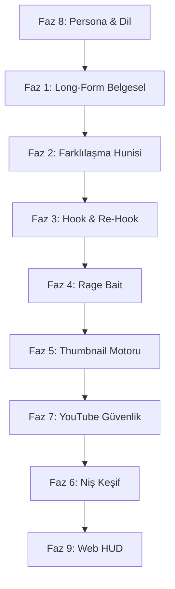

# 🌊 Global Wave — 6 Video Transkript Entegrasyon Master Planı

> **Tarih:** 15 Ekim 2026  
> **Amaç:** Erkan Kolcu'nun 6 eğitim videosundaki tüm kanıtlanmış stratejileri Global Wave v3.1 otomasyon motoruna entegre etmek  
> **Mevcut Durum:** Sistem Shorts (30-60 sn) üretiyor, YouTube'a yüklüyor, Whisper karaoke altyazı ve SFX kullanıyor  
> **Hedef:** Transkriptlerdeki tüm eksik stratejileri sisteme kodlayarak hem Shorts hem Long-Form belgesel üretebilen, rakip analizi yapan, farklılaşma hunisi uygulayan ve kapak/başlık optimizasyonu yapan tam otonom bir fabrika haline getirmek

---

## 📋 Faz Özeti

| Faz | Başlık | Değişen Dosyalar | Karmaşıklık |
|:---:|:-------|:-----------------|:-----------:|
| **1** | Long-Form Belgesel Modu (11-16 dk) | `script_engine.py`, `video_engine.py`, `voice_engine.py`, `server.py` | 🔴 Yüksek |
| **2** | Farklılaşma Hunisi & Metin İnsanlaştırma | `script_engine.py` (yeni modül: `humanizer.py`) | 🟡 Orta |
| **3** | Hook & Re-Hook + Seamless Loop Motoru | `script_engine.py`, `video_engine.py` | 🟡 Orta |
| **4** | Rage Bait & Yorum Kışkırtma Jeneratörü | Yeni modül: `engagement_engine.py`, `server.py` | 🟢 Düşük |
| **5** | Otomatik Thumbnail/Kapak Üretim Motoru | Yeni modül: `thumbnail_engine.py`, `server.py` | 🟡 Orta |
| **6** | Rakip Analiz & Niş Keşif Modülü | Yeni modül: `niche_engine.py`, `server.py` | 🟡 Orta |
| **7** | YouTube Güvenlik Zırhı & Upload Protokolü | `uploader_youtube.py`, `server.py` | 🟢 Düşük |
| **8** | Persona Genişletme & Dil Stratejisi | `personas.py` | 🟢 Düşük |
| **9** | Web HUD Güncelleme | `index.html`, `app.js`, `style.css` | 🟡 Orta |

---

## 🔴 FAZ 1 — Long-Form Belgesel Modu (11-16 Dakika)

### Kaynak Transkriptler
- `0dan-aylık-200000TL` → Tornado belgesel, 12 dk, 26 sahne, sahne başına 30 sn görsel
- `Sıfırdan-aylık-80.000TL` → Finans+Tarih belgesel, yatay format (1920x1080)
- `Yüzsüz-TAM-KURS-2-saat` → 13.000 karakter = 13 dakika, 26 sahne mantığı

### Mevcut Eksiklik
Şu an `script_engine.py` sadece 30s / 45s / 60s Shorts üretebiliyor. Long-form (10-16 dk) desteği yok. `video_engine.py` sadece dikey (1080x1920) render yapıyor; yatay format (1920x1080) desteği yok.

### Yapılacaklar

#### 1.1 `script_engine.py` — Uzun Form Senaryo Desteği
- [ ] `get_duration_specs()` fonksiyonuna yeni süre profilleri ekle:
  - `"10min"` → 10 dakika, ~2.300 kelime, 20 sahne
  - `"12min"` → 12 dakika, ~2.800 kelime, 24 sahne  
  - `"14min"` → 14 dakika, ~3.250 kelime, 26 sahne
  - `"16min"` → 16 dakika, ~3.700 kelime, 30 sahne
- [ ] `CINEMATIC_SYSTEM_PROMPT` içine long-form belgesel direktifleri ekle:
  - "Kronolojik hikaye anlatımı kullan"
  - "Her 30 saniyede yeni bir sahne/görsel değişimi yap"
  - "Net Information Gain (NIG): En az 15-20 yeni/bilinmeyen bilgi entegre et"
  - "POV anlatımı: İzleyiciyi olayın tam ortasına çek ('Oklahoma otoyolundasınız...')"
  - "Gerilim eğrisi: Açılış korkusu → Bağlam → Tırmanış → Doruk → Çözüm/CTA"
- [ ] Ollama model seçimi: Long-form için daha büyük context window gerekli; `qwen3:14b` veya `qwen3:30b` tercih et

#### 1.2 `video_engine.py` — Yatay Format & Ken Burns Efekti
- [ ] `normalize_clip()` fonksiyonuna `orientation` parametresi ekle:
  - `"vertical"` → 1080x1920 (Shorts, mevcut)
  - `"horizontal"` → 1920x1080 (Long-form belgesel)
- [ ] **Ken Burns efekti** (zoompan) ekle: Statik görselleri hareketli hale getir
  - Yavaş zoom-in: `zoompan=z='min(zoom+0.0015,1.5)':d=150:s=1920x1080`
  - Yavaş pan (sola/sağa kayma): `zoompan=z=1.1:x='iw/2-(iw/zoom/2)+on*2'`
  - Her sahnede rastgele zoom-in veya pan seçimi
- [ ] `render_master_video()` içine yatay format desteği ve sahne geçiş efektleri (xfade crossfade) ekle

#### 1.3 `voice_engine.py` — Uzun Metin Seslendirme
- [ ] `generate_scene_audios()` fonksiyonunu 20-30 sahnelik uzun metinleri chunk'layarak seslendirmeye uygun hale getir
- [ ] ElevenLabs API entegrasyonu (isteğe bağlı, long-form için daha doğal ses):
  - `tokens.json`'a `elevenlabs_api_key` ve `elevenlabs_voice_id` alanları ekle
  - Ken France benzeri tok, derin erkek sesi seçimi

#### 1.4 `material_engine.py` — Yatay Stok Video Arama
- [ ] `query_pexels_api()` fonksiyonuna `orientation=landscape` desteği ekle
- [ ] Kamu malı (public domain) arşiv videoları için ek kaynak: Archive.org API veya lokal arşiv klasörü (`assets/archive_footage/`)

#### 1.5 `server.py` — API & HUD Entegrasyonu
- [ ] `/api/generate` endpoint'ine `video_type` parametresi ekle: `"shorts"` veya `"longform"`
- [ ] `/api/generate` endpoint'ine `orientation` parametresi ekle: `"vertical"` veya `"horizontal"`

---

## 🟡 FAZ 2 — Farklılaşma Hunisi & Metin İnsanlaştırma Motoru

### Kaynak Transkriptler
- `Sıfırdan-aylık-80.000TL` → "Farklılaşma Hunisi": Ton değiştir, dil çevir, görsel stil değiştir
- `YouTube-kanalını-yeniden-markalayarak` → "Her şeyi AI'a bırakma, insanlaştır"
- `Yüzsüz-TAM-KURS` → "NRC AI ile harmanlama, 2 metni birleştir"

### Mevcut Eksiklik
`script_engine.py` Ollama'dan ham JSON alıyor ve doğrudan kullanıyor. Metin insanlaştırma, farklılaşma ve NIG (Net Information Gain) enjeksiyonu yok.

### Yapılacaklar

#### 2.1 Yeni Modül: `engine/humanizer.py`
- [ ] `humanize_script(script_data, style)` fonksiyonu oluştur:
  - **Giriş:** Ollama'dan gelen ham senaryo JSON'u
  - **İşlem 1 — Ton Farklılaştırma:** Samimi/arkadaş canlısı ("sanki kardeşime anlatıyorum") veya belgesel-gerilim tonu seçimi
  - **İşlem 2 — Klişe Temizliği:** "İnsanlar Roma'nın çöküşünü düşündüğünde..." → "Roma'nın yok oluşunu hayal ettiğinde genellikle aynı sahneleri gözünde canlandırırsın..." gibi yapay zeka kokusunu çıkaran cümle dönüşümleri
  - **İşlem 3 — NIG Enjeksiyonu:** Ollama'ya "Bu konuda daha önce duyulmamış 5 ilginç bilgi ver" sorusu sorarak metnin içine yeni bilgiler serpiştir
  - **İşlem 4 — İnsansı Kusur:** Tam mükemmel olmayan, hafif konuşma dili eklemeleri (YouTube algoritmasının AI metnini elemesini önlemek için)
- [ ] İkinci bir Ollama çağrısı ile "insanlaştırılmış" metin üret ve orijinalin yerine koy

#### 2.2 `script_engine.py` — Pipeline'a Entegrasyon
- [ ] `generate_script()` fonksiyonunun sonuna `humanize_script()` çağrısı ekle
- [ ] HUD'dan `humanize_level` parametresi al: `"off"`, `"light"`, `"deep"`

---

## 🟡 FAZ 3 — Hook & Re-Hook + Seamless Loop Motoru

### Kaynak Transkriptler
- `Bu-YouTube-Shorts-Strajtejisi` → "Hook ve Re-Hook, videonun en çarpıcı anını 0-0.5 saniyeye koy"
- `Bu-YouTube-Shorts-Strajtejisi` → "%200 retention: Videonun sonu başa bağlanmalı (loop)"
- `0dan-aylık-200000TL` → "Kurtulma şansı yok, tehlike, korku hissiyatı ile başla"

### Mevcut Eksiklik
`CINEMATIC_SYSTEM_PROMPT` içinde `seamless_loop_word` var ama video montajında uygulanmıyor. Re-Hook (ikinci kanca) konsepti yok. Videonun en çarpıcı sahnesini öne çekme (teaser) mekanizması yok.

### Yapılacaklar

#### 3.1 `script_engine.py` — Çift Kanca Yapısı
- [ ] Prompt'a `"re_hook"` sahne rolü ekle (hook'tan hemen sonra gelen 2. kanca):
  - `scene_id: 0` → `role: "hook"` (0-3 sn, kaydırmayı durduran sarsıcı açılış)
  - `scene_id: 1` → `role: "re_hook"` (3-6 sn, merakı pekiştiren 2. darbe)
- [ ] `seamless_loop_word` alanını zorunlu hale getir ve son sahnenin son cümlesinin birinci sahnenin ilk cümlesine akması için özel prompt talimatı ekle
- [ ] Duygu bazlı hook kategorileri:
  - `"danger"` → Tehlike, korku, kurtulma şansı yok
  - `"curiosity"` → Merak, "bunu ilk defa duyacaksın"
  - `"controversy"` → Tartışma, taraf tutturma
  - `"record"` → Rekorlar ve enler, istatistikler

#### 3.2 `video_engine.py` — Teaser Splice (Çarpıcı An Öne Çekme)
- [ ] Shorts modunda: Videonun en görsel-yoğun sahnesinin (örn: sahne 3 veya 4) ilk 0.5-1 saniyesini kesip videonun en başına yapıştır, sonra ana akışa dön
- [ ] Bu "flash teaser" için FFmpeg `trim` + `concat` filtresi kullan

---

## 🟢 FAZ 4 — Rage Bait & Yorum Kışkırtma Jeneratörü

### Kaynak Transkriptler
- `Bu-YouTube-Shorts-Strajtejisi` → Kasıtlı typo, arka plan rage bait, yorum soru promptu

### Yapılacaklar

#### 4.1 Yeni Modül: `engine/engagement_engine.py`
- [ ] `generate_rage_bait(script_text, style)` fonksiyonu:
  - **Typo Injector:** Metindeki 1 rastgele kelimeye kasıtlı yazım hatası ekle (altyazıda görünecek)
  - **Soru Üretici:** Ollama'ya metin verilip "Bu videoyu izleyen birinin hakkında yorum yapacağı 3 kışkırtıcı soru yaz" komutu
  - **CTA Güçlendirici:** Video sonu CTA'sını "Bunu yapabilen var mı? Yoruma yaz!" gibi taraf tutturan formata çevir
- [ ] Çıktı: `engagement_data` JSON → Altyazıya typo, açıklamaya sorular, CTA metnine güçlendirme

#### 4.2 `server.py` Entegrasyonu
- [ ] `/api/generate` endpoint'ine `enable_rage_bait` parametresi (bool)
- [ ] HUD'da toggle switch: "🔥 Yorum Kışkırtma Modu"

---

## 🟡 FAZ 5 — Otomatik Thumbnail/Kapak Üretim Motoru

### Kaynak Transkriptler
- `0dan-aylık-200000TL` → "Kırmızı büyük bold fontlar, tehlike hissi, olayın hemen öncesi"
- `Sıfırdan-aylık-80.000TL` → Photoshop: kontrast, dış ışıma, mobil uyumluluk
- `Yüzsüz-TAM-KURS` → Click Vision ile rakip kapak modellemesi

### Mevcut Eksiklik
Sistem hiç kapak/thumbnail üretmiyor. YouTube'a yüklerken kapaksız gidiyor.

### Yapılacaklar

#### 5.1 Yeni Modül: `engine/thumbnail_engine.py`
- [ ] `generate_thumbnail(topic, scenes, style_preset)` fonksiyonu:
  - **Adım 1 — Arka Plan Görseli:** Pexels API'den konuya uygun yatay fotoğraf çek VEYA Leonardo AI / DALL-E API ile özel görsel üret
  - **Adım 2 — Metin Overlay:** Pillow (PIL) kütüphanesi ile kapak üzerine büyük, bold, kırmızı veya sarı başlık yaz
    - Font: Impact, Montserrat Black veya Arial Black
    - Konumlandırma: Üst 1/3 bölge, sol hizalı
    - Kontrast: Yazının arkasına siyah gradient katmanı (okunabilirlik)
    - Dış ışıma (glow) ve gölge efekti
  - **Adım 3 — Mobil Uyumluluk:** 1280x720 çıktı, yazılar telefonda okunabilir boyutta (min 48px)
  - **Adım 4 — Çıktı:** `output/thumbnails/thumb_{task_id}.jpg`
- [ ] Stil presetleri:
  - `"danger_red"` → Kırmızı başlık, karanlık arka plan, tehlike hissi
  - `"curiosity_yellow"` → Sarı başlık, merak uyandıran
  - `"split_compare"` → Görseli ikiye böl (öncesi/sonrası)
  - `"record_stats"` → İstatistik ve sayılar vurgulu

#### 5.2 `uploader_youtube.py` — Thumbnail Ekleme
- [ ] `upload_short_video()` fonksiyonuna `thumbnail_path` parametresi ekle
- [ ] YouTube Data API v3 `thumbnails().set()` çağrısı ile kapak yükle

#### 5.3 `server.py` — API
- [ ] `/api/thumbnail/generate` endpoint'i: Önizleme amaçlı kapak üret
- [ ] `/api/generate` pipeline'ına otomatik thumbnail üretim adımı ekle

---

## 🟡 FAZ 6 — Rakip Analiz & Niş Keşif Modülü

### Kaynak Transkriptler
- `YouTubedan-aylık-3000-gelir` → Gizli sekme araştırması, Nichel benzeri niş bulucu
- `0dan-aylık-200000TL` → Gemini ile rakip thumbnail analizi, ortak başarı noktaları
- `YouTube-kanalını-yeniden-markalayarak` → 25-50 kanal analizi, NRC AI

### Yapılacaklar

#### 6.1 Yeni Modül: `engine/niche_engine.py`
- [ ] `analyze_competitor(channel_url_or_id)` fonksiyonu:
  - YouTube Data API v3 ile kanalın son 20 videosunun başlık, izlenme, beğeni, yorum sayısı ve yüklenme tarihini çek
  - Abone/izlenme oranı hesapla (düşük abone + yüksek izlenme = fırsat nişi)
  - Ortalama video süresi hesapla
  - Ollama'ya bu verileri verip "Bu kanalın başarı kalıpları nedir?" analizi yaptır
- [ ] `discover_niche(broad_keyword, language)` fonksiyonu:
  - YouTube Data API v3 `search().list()` ile anahtar kelime araması
  - Sonuçlardan "düşük aboneli ama yüksek izlenmeli" kanalları filtrele
  - Her birinin `analyze_competitor()` sonucunu döndür
- [ ] `find_common_patterns(channel_list)` fonksiyonu:
  - Birden fazla rakip kanalın ortak başarı kalıplarını Ollama ile çıkar
  - Çıktı: Ortak duygu (tehlike, merak, rekor), ortak video süresi, ortak kapak stili

#### 6.2 `server.py` — API
- [ ] `POST /api/niche/analyze` → Tekil kanal analizi
- [ ] `POST /api/niche/discover` → Anahtar kelimeyle niş keşfi
- [ ] `POST /api/niche/patterns` → Çoklu kanal ortak kalıp analizi

---

## 🟢 FAZ 7 — YouTube Güvenlik Zırhı & Upload Protokolü

### Kaynak Transkriptler
- `Yüzsüz-TAM-KURS` → "Videoyu gizli yükle, 2-3 saat beklet, sonra herkese açık yap"
- `Yüzsüz-TAM-KURS` → "6 aylık Gmail, 3. seviye doğrulama, iletişim maili ayrı"
- `YouTube-kanalını-yeniden-markalayarak` → "7 günlük kanal ısıtma protokolü"

### Mevcut Eksiklik
`uploader_youtube.py` videoyu doğrudan `"public"` olarak yüklüyor. Gizli yükleme ve gecikmeli yayınlama yok. İnsansı bekleme süreleri yok.

### Yapılacaklar

#### 7.1 `uploader_youtube.py` — Güvenli Yükleme Protokolü
- [ ] Varsayılan yükleme durumunu `"private"` (gizli) olarak değiştir
- [ ] `schedule_publish(video_id, delay_hours=3)` fonksiyonu ekle:
  - Video yüklendikten 2-3 saat sonra otomatik olarak `"public"` yap
  - YouTube Data API `videos().update()` ile `privacyStatus` güncelle
- [ ] İnsansı bekleme: Upload'lar arası `random.uniform(45, 120)` dakika rastgele bekleme
- [ ] Günlük yükleme limiti: Maksimum 3 video/gün (shadow ban koruması)
- [ ] SEO otomasyonu: `script_engine.py`'den gelen konuya göre Ollama'ya otomatik başlık, açıklama ve etiket yazdır

#### 7.2 Kanal Isıtma Hatırlatıcısı (HUD'da Bilgilendirme)
- [ ] Yeni kanal bağlandığında HUD'da 7 günlük ısıtma protokolü checklist'i göster:
  - Gün 1-3: Nişteki popüler videoları izle, beğen, 2 yorum yap
  - Gün 4-5: Banner, profil, açıklama tamamla
  - Gün 6-7: 1 test video gizli yükle, telif taraması bekle

---

## 🟢 FAZ 8 — Persona Genişletme & Dil Stratejisi

### Kaynak Transkriptler
- `Sıfırdan-aylık-80.000TL` → "Almanca %80, İngilizce %60, İspanyolca %40 öneriyorum"
- `YouTubedan-aylık-3000-gelir` → "İçeriği farklı dillere çevirin, çevirinin telifi yoktur"

### Mevcut Eksiklik
5 persona var ama İspanyolca (es-ES/es-MX) persona eksik. Almanca persona finans/tarih belgesel tonunda değil, teknik/mühendislik tonunda.

### Yapılacaklar

#### 8.1 `personas.py` — Yeni Personalar & Ton Güncelleme
- [ ] Yeni persona ekle: `"es_narrator"` (İspanyolca Belgesel Anlatıcısı)
  - Dil: `es-ES` veya `es-MX`
  - Ses: `es-ES-AlvaroNeural` veya `es-MX-JorgeNeural`
  - Ton: Dramatik belgesel, tarihsel hikaye anlatımı, samimi
  - Hedef kitle: İspanyolca konuşan 18-45 yaş, tarih ve bilim meraklıları
- [ ] Yeni persona ekle: `"tr_storyteller"` (Türkçe Hikaye Anlatıcısı — Sandbox test)
  - Dil: `tr-TR`
  - Ses: `tr-TR-AhmetNeural`
  - Ton: Samimi, arkadaş canlısı, sanki kardeşine anlatır gibi
- [ ] `de_engineer` personasının tonuna **finans/tarih belgesel** alternatifi ekle veya yeni `"de_historian"` personası oluştur
- [ ] Her personaya `"recommended_niches"` alanı ekle (Almanca: fırtına, tarih, mühendislik; İspanyolca: tarih, kültür, gizemler)

#### 8.2 Çoklu Dil Çeviri Hattı
- [ ] `script_engine.py` veya yeni `translator.py` modülü:
  - Bir dilde üretilen senaryoyu otomatik olarak başka dillere çevir
  - Ollama'ya "Bu metni X diline çevir ama lokalize et, o kültürün jargonunu kullan" talimatı
  - Çevirinin telifi olmadığı için aynı konuyu 3 farklı dilde üretip 3 farklı kanala yükleme

---

## 🟡 FAZ 9 — Web HUD Güncelleme

### Yapılacaklar

#### 9.1 `index.html` + `app.js` — Yeni Kontroller
- [ ] Video üretim formuna yeni alanlar:
  - **Video Tipi** dropdown: `Shorts (30-60s)` | `Long-Form Belgesel (10-16 dk)`
  - **Oryantasyon** dropdown: `Dikey (9:16)` | `Yatay (16:9)`
  - **İnsanlaştırma Seviyesi** slider: `Kapalı` | `Hafif` | `Derin`
  - **Yorum Kışkırtma** toggle: `🔥 Rage Bait Modu`
  - **Hook Tipi** dropdown: `Tehlike` | `Merak` | `Tartışma` | `Rekor`
- [ ] **Thumbnail Önizleme Paneli:**
  - Video üretildikten sonra otomatik kapak göster
  - "Yeniden Üret" butonu
  - Stil seçimi (Danger Red, Curiosity Yellow, Split Compare)
- [ ] **Niş Keşif Sekmesi (yeni sekme):**
  - Anahtar kelime giriş alanı
  - "Fırsat Nişi Bul" butonu
  - Bulunan kanalları kart olarak göster (abone, izlenme, oran)
  - "Rakip Analiz Et" butonu → Ortak kalıplar raporu
- [ ] **Kanal Isıtma Checklist'i:**
  - Yeni kanal bağlandığında 7 günlük görev listesi göster
  - Her gün tamamlandığında checkbox ile işaretle

#### 9.2 `style.css` — Yeni Bileşen Stilleri
- [ ] Thumbnail önizleme kartı stili
- [ ] Niş keşif kartları stili
- [ ] Checklist bileşeni stili

---

## 🗓️ Önerilen Uygulama Sırası



**Önerilen başlangıç sırası:**
1. **Faz 8** (Persona, en basit, temeli oluşturur)
2. **Faz 7** (YouTube güvenlik, kritik koruma)
3. **Faz 3** (Hook/Re-Hook, mevcut Shorts'u hemen güçlendirir)
4. **Faz 4** (Rage Bait, hemen etki yaratan küçük modül)
5. **Faz 2** (Farklılaşma/İnsanlaştırma, metin kalitesini yükseltir)
6. **Faz 1** (Long-Form, en büyük yeni özellik)
7. **Faz 5** (Thumbnail, long-form ile birlikte kritik)
8. **Faz 6** (Niş Keşif, operasyonel zenginlik)
9. **Faz 9** (HUD, tüm yeni özellikler bittikten sonra arayüz)

---

## 📁 Yeni Dosya Yapısı (Plan Sonrası)

```
Global-Wawe/
├── engine/
│   ├── script_engine.py        ← GÜNCELLENİR (long-form, hook tipi, NIG)
│   ├── video_engine.py         ← GÜNCELLENİR (yatay format, Ken Burns, teaser splice)
│   ├── voice_engine.py         ← GÜNCELLENİR (ElevenLabs API, uzun metin)
│   ├── material_engine.py      ← GÜNCELLENİR (landscape arama)
│   ├── personas.py             ← GÜNCELLENİR (yeni personalar)
│   ├── subtitle_whisper.py     ← MEVCUT (değişiklik yok)
│   ├── sfx_engine.py           ← MEVCUT (değişiklik yok)
│   ├── uploader_youtube.py     ← GÜNCELLENİR (güvenli upload)
│   ├── autonomous_feedback.py  ← MEVCUT (değişiklik yok)
│   ├── laya_decision_engine.py ← MEVCUT (değişiklik yok)
│   ├── voice_kokoro.py         ← MEVCUT (değişiklik yok)
│   ├── humanizer.py            ← YENİ (Faz 2)
│   ├── engagement_engine.py    ← YENİ (Faz 4)
│   ├── thumbnail_engine.py     ← YENİ (Faz 5)
│   ├── niche_engine.py         ← YENİ (Faz 6)
│   └── translator.py           ← YENİ (Faz 8)
├── web/
│   ├── server.py               ← GÜNCELLENİR (yeni API'ler)
│   ├── templates/index.html    ← GÜNCELLENİR (yeni kontroller)
│   └── static/
│       ├── app.js              ← GÜNCELLENİR
│       └── style.css           ← GÜNCELLENİR
└── output/
    └── thumbnails/             ← YENİ (Faz 5 çıktısı)
```

---

## ⚠️ Riskler & Dikkat Edilecek Noktalar

| Risk | Açıklama | Önlem |
|:-----|:---------|:------|
| **Ollama Context Sınırı** | 12 dk metin (~3000 kelime) üretmek Qwen 8B için çok büyük olabilir | Long-form için `qwen3:14b` veya `qwen3:30b` kullan, gerekirse sahne sahne üret |
| **ElevenLabs Maliyet** | Uzun metinler çok karakter harcar | Sandbox'ta Edge-TTS veya Kokoro kullan, sadece final üretimde ElevenLabs |
| **YouTube API Kota** | Niş keşif çok fazla API çağrısı yapabilir | Günlük kota takibi, cache mekanizması |
| **Thumbnail Kalitesi** | Pillow ile üretilen kapaklar Photoshop kalitesinde olmayabilir | Preset şablonlar hazırla, kullanıcıya "dışarıda düzenle" seçeneği sun |
| **AI Metin Tespiti** | YouTube'un AI metin algılaması | Humanizer modülü zorunlu, her metne insani dokunuş |

---

> [!IMPORTANT]
> Bu plan **onayınıza bağlıdır**. Onay verdiğinizde, önerilen sırayla (Faz 8 → Faz 7 → Faz 3 → ...) kodlamaya başlayacağım. İsterseniz sıralamayı değiştirebilir, bazı fazları çıkarabilir veya yeni fazlar ekleyebilirsiniz.
